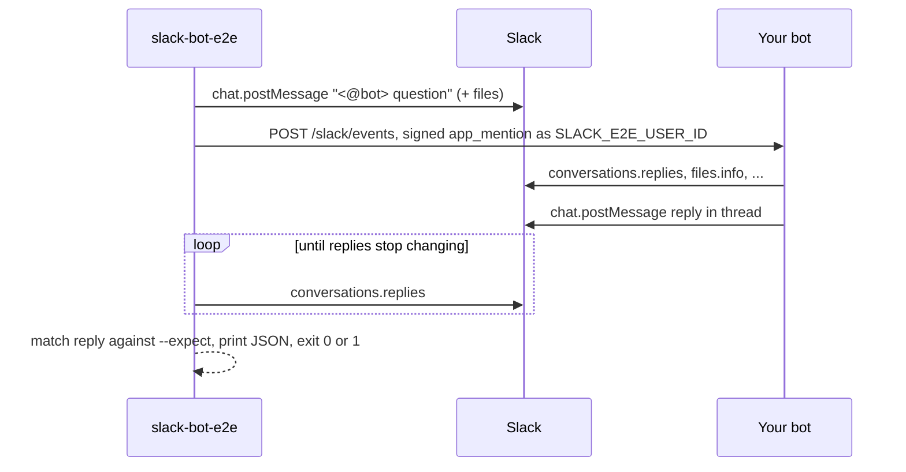

# slack-bot-e2e

[](https://github.com/yulonghe97/slack-bot-e2e/actions/workflows/ci.yml)
[](LICENSE)


An [agent skill](https://agentskills.io) and a zero-dependency CLI for end-to-end testing a Slack bot through a real Slack channel, with no person at the keyboard.

It posts a message that mentions your bot, sends the bot a correctly signed `app_mention` event as a real user, waits for the bot's reply to land in Slack, and checks it against a regex. Your bot runs its real handler, reads the real thread and files from Slack, and posts a real reply.

Works with any bot that receives events over HTTP: Bolt for JavaScript, Bolt for Python, or a custom handler, running locally or deployed.

## Why

A Slack app cannot trigger its own `app_mention`, so automated tests usually stop at a unit test with a mocked payload. That misses the parts that break in practice: signature checks, thread reads, file downloads, streaming replies, and what the user actually sees in the channel.

`slack-bot-e2e` fakes only the delivery of the event. Everything else is real.



## Install

As a skill for Claude Code, Codex, Cursor and other agents that read `SKILL.md`:

```bash
npx skills add yulonghe97/slack-bot-e2e
```

Or copy `skills/slack-bot-e2e` into your agent's skills folder, for example `~/.claude/skills/`.

Without an agent, run the script directly. It needs only Node 20 or later:

```bash
git clone https://github.com/yulonghe97/slack-bot-e2e
node slack-bot-e2e/skills/slack-bot-e2e/scripts/slack-e2e.mjs whoami
```

## Set up

1. Use a dedicated test Slack app and a test channel, and invite the bot to it. Every command posts real messages, so never point this at a production channel.
2. Give the bot token `chat:write`, `files:write`, `files:read` and `channels:history` (`groups:history` for a private channel).
3. Start your bot so its Events API endpoint is reachable from the machine running the test. Localhost is fine: the script posts the event itself, so you need no tunnel.
4. Set these variables, in your shell or in a `.env` passed with `node --env-file=.env`:

| Variable | Value |
| --- | --- |
| `SLACK_E2E_BOT_TOKEN` | Bot token (`xoxb-…`) of the app under test |
| `SLACK_E2E_SIGNING_SECRET` | Signing secret of the same app |
| `SLACK_E2E_CHANNEL_ID` | Test channel ID (`C…`) |
| `SLACK_E2E_USER_ID` | Human user the events claim to come from (`U…`) |
| `SLACK_E2E_EVENTS_URL` | Your bot's Events API URL, for example `http://localhost:3000/slack/events` |

Run `whoami` to confirm the token resolves to the bot, team and app you expect.

## Usage

```bash
alias slack-e2e="node --env-file=.env skills/slack-bot-e2e/scripts/slack-e2e.mjs"

slack-e2e whoami
slack-e2e send --text "Total revenue in the attached CSV?" --file sales.csv --expect "\\b400\\b"
slack-e2e post --text "The launch code is PELICAN" --deliver
slack-e2e send --thread 1761830000.123456 --text "What is the launch code?" --expect pelican
slack-e2e read --thread 1761830000.123456
```

| Command | What it does |
| --- | --- |
| `send` | Posts `<@bot> <text>` with optional files, in a new thread or `--thread`, delivers a signed `app_mention`, and waits for the reply. Exits 1 if no reply settles within `--timeout` seconds (default 180) or the reply does not match `--expect`. |
| `post` | Posts without a mention to set up thread context. `--deliver` also sends a signed `message` event, for bots that capture channel history. |
| `read` | Prints every message in a thread with its user, files, reactions and streaming state. |
| `whoami` | Prints the resolved bot user, team, app, channel and events URL. |

`send` prints JSON you can paste into a pull request as evidence:

```json
{
  "eventId": "EvE2E3f1c…",
  "failures": [],
  "passed": true,
  "replies": [{ "text": "Total revenue is 400.", "ts": "1761830004.000200", "user": "U0BOT" }],
  "threadTs": "1761830001.000100",
  "ts": "1761830001.000100"
}
```

A reply counts as settled when it comes from the bot after the mention, no message is still streaming, and the thread is unchanged across two polls. `--expect` is a case-insensitive regex over all replies joined.

## Writing good checks

- Make the answer impossible to guess: an exact number from a fixture, a code hidden in an image, a word that appears only earlier in the thread.
- Test one behaviour per `send`. Seed context with `post` instead of packing it into the mention.
- When a check fails, read `failures` and your bot's logs before changing code.

## Limits

- Only event delivery is synthetic. Slack's retries, Event Subscriptions URL verification and interactive components (button clicks) still need a person and a public URL.
- Slack shows the seeded messages as posted by the bot; only the event says they came from `SLACK_E2E_USER_ID`.
- Socket Mode bots have no HTTP endpoint, so `send` cannot reach them.
- Replies are matched by the bot's user ID. A bot that answers with a different token or as another user is not seen.

## Development

```bash
npm test
```

The tests run the CLI against an in-process fake of the Slack Web API and a fake bot that verifies signatures, so they need no Slack workspace or network access.

## License

[MIT](LICENSE)
